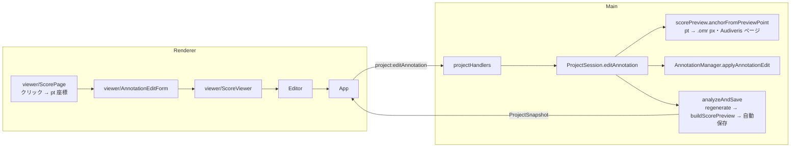

# 設計書

## アーキテクチャ概要

**編集は「注釈レイヤーを書き換えて解析を流し直す」だけにする**。#4 までの「訂正 → パイプライン全体を頭から流す」と同じ方式で、
差分更新はしない（状態の食い違いを生まない。1 曲の再解析は数百 ms）。

- 注釈レイヤー（`Project.annotations`）の書き換えは domain の純関数（`AnnotationManager`）で行う。
  既存の `addAnnotation` / `updateAnnotation` / `removeAnnotation` に、編集コマンドを適用する入口 `applyAnnotationEdit` を足す
- `regenerateAnnotations` は既に「手動注釈・`deleted`・手動上書き `text` を id で引き継ぐ」ため、流し直しても編集は保全される
  （受け入れ条件「再計算後も手動注釈と削除フラグが保全される」は既存の仕組みで満たす。テストで固定する）
- 画面の座標（pt・左上原点・**元PDFのページ**）から注釈のアンカー（`.omr` px・**Audiveris のページ**）への逆変換は Main（domain）で行う。
  Renderer は `PageInfo` の対応表を持たないうえ、変換の縮尺を OverlayRenderer と共有するため
- 保存は既存の自動保存（`analyzeAndSave` → 300ms デバウンス）に乗せる。スキーマは変更しない（`Annotation` は v1 から永続化済み）



## コンポーネント設計

### 1. 編集コマンドの型（shared/ipc/contract.ts）

```typescript
/** 楽譜プレビュー上での注釈の編集（Renderer → Main） */
export type AnnotationEdit =
  /** 元PDF のページ上の位置（pt・左上原点）に手動注釈を足す。位置は文字の左端＋ベースライン */
  | { kind: 'add'; sourcePageIndex: number; x: number; y: number; text: string }
  /** 文字を書き換える。null は自動注釈の上書きの取り消し（元の階名に戻す） */
  | { kind: 'setText'; id: string; text: string | null }
  /** 削除する（自動注釈は deleted を立てる。手動注釈は消す） */
  | { kind: 'remove'; id: string }
  /** 削除した自動注釈を元に戻す */
  | { kind: 'restore'; id: string };
```

- IPC は 1 チャネル `project:editAnnotation`（`(edit: AnnotationEdit) => IpcResult<ProjectSnapshot>`）にまとめる。
  操作ごとにチャネルを分けると、preload・contract・handlers・main/index の 4 か所へ 4 倍の配線が要り、すべて「スナップショットを返す」同じ形になるため
- `add` は画面の座標で送る。Renderer は `PageInfo`（Audiveris ページ ↔ 元PDFページ）を持たず、縮尺も domain にしかないため

### 2. `applyAnnotationEdit`（domain/annotations/AnnotationManager.ts・変更）

```typescript
export type AnnotationEditCommand =
  | { kind: 'add'; id: string; anchor: PageAnchor; text: string } // Main が id とアンカーを確定済み
  | { kind: 'setText'; id: string; text: string | null }
  | { kind: 'remove'; id: string }
  | { kind: 'restore'; id: string };

export function applyAnnotationEdit(
  annotations: readonly Annotation[],
  command: AnnotationEditCommand,
): Annotation[];
export function normalizeAnnotationText(text: string): string | null; // 前後の空白を除き、空なら null
```

**実装の要点**:

- `add` の文字の正規化と id の重複検査もここで行う（実装時に変更: 当初は完成した `Annotation` を受け取る案だったが、文字の検証を 1 か所に集めるため）
- 不正な編集は `Error` を投げる（UI が防いでいる入力のため、利用者の回復手段は要らない。`IpcResult` の `unexpected` で届く）
  - 存在しない id、手動注釈の上書き取り消し（手動注釈は文字が唯一の内容）、削除されていない注釈の `restore`、手動注釈の `restore`
- `setText` の文字列は `normalizeAnnotationText` を通し、空なら拒否する（空文字の注釈は描けず、見えない注釈が残る）
- `remove` は既存の `removeAnnotation`（自動は `deleted`、手動は実体を消す）
- `restore` は `deleted: false` に戻す。位置は次の流し直しで `regenerate` が配置し直す（`deleted` の間は前回位置を引き継いでいるだけのため）

### 3. 画面座標 → アンカーの逆変換（domain/render/coordinateTransform.ts / scorePreview.ts・変更）

- `coordinateTransform.fromPreviewPoint(page, x, y)`: `toPreviewPoint` の逆（pt → `.omr` px）。縮尺の求め方を共有し、変換できないページは null
- `scorePreview.anchorFromPreviewPoint({ pages, omrPages, sourcePageIndex, x, y }): PageAnchor | null`
  - `sourcePageIndex` が一致し、変換できる `PageInfo` を候補にする
  - **候補が複数（Victoria の sheet#1 = Audiveris page 0 と 1）なら、押した位置に最も近い段を持つページを選ぶ**。
    段の縦範囲は譜表の譜線範囲（`OmrStaff.extent`）の和集合。範囲内なら距離 0。段の範囲が分からなければ先頭の候補
    - ページの選択は描画位置には影響しない（同じ sheet の画像を共有し、縮尺が同じ）が、`regenerate` の衝突回避（自動注釈が手動注釈を避ける）がページ単位のため、
      押した位置の音符と同じページに属させる
  - 座標が有限でない、ページの範囲外（0 未満・寸法超え）なら null

### 4. `ProjectSession.editAnnotation`（main/ProjectSession.ts・変更）

```typescript
editAnnotation(edit: AnnotationEdit): SessionSnapshot
```

- `add`: `anchorFromPreviewPoint` でアンカーを求め（null なら `Error`）、文字を正規化し（空なら `Error`）、
  id を `manual-<UUID>` で振って `addAnnotation` の結果を `applyAnnotationEdit` に渡す
  - id の生成はコンストラクタで差し替え可能にする（`deps.createAnnotationId`。テストで決定的にするため）。既定は `node:crypto` の `randomUUID`
- 他の操作はそのまま `applyAnnotationEdit` へ
- `this.unmatched = []`、**承認は無効化しない**（設定変更と同じ。注釈の手直しは「何を確認したか」＝音部記号・調・構造を変えない）
- `analyzeAndSave()` で流し直し、自動保存を予約する

### 5. プレビューの注釈に編集用の情報を足す（shared/types/ScorePreview.ts / scorePreview.ts・変更）

```typescript
export interface ScorePreviewAnnotation {
  // 既存: id, x, y, text, chromatic
  origin: 'auto' | 'manual';
  /** 自動注釈の文字を手で書き換えてあるか（「元の階名に戻す」を出すかどうか） */
  overridden: boolean;
}
```

### 6. 楽譜プレビューでの編集 UI（renderer/viewer/・変更／新規）

**ScoreViewer（変更）**:

- props に `editable: boolean` と `onEditAnnotation?: (edit: AnnotationEdit) => void` を足す
- 編集中の対象 `draft` を 1 つだけ持つ: `{ kind: 'add'; sourcePageIndex; x; y } | { kind: 'edit'; sourcePageIndex; annotation }`
  - `editable` が false になったら閉じる（処理中・編集をやめた）
  - 送信したら閉じる（結果は新しいスナップショットとして届く。失敗は App の通知に出る）

**ScorePage（変更）**:

- `editable` のとき、重ねるものが無いページにも SVG を置く（どのページにも書き足せるように。`viewBox` は `size` から）
- SVG のクリック → 表示上の位置を `getBoundingClientRect` からページのポイント座標へ直し、`onPick({ kind: 'add', x, y })`
  - スキップ小節の枠の上でも追加になる（欠けた階名を書き足す主な場所のため、枠はクリックを奪わない）
- 注釈の `<text>` のクリック → `stopPropagation` して `onPick({ kind: 'edit', annotation })`。押しやすいよう `cursor: pointer`
- 追加位置には小さな印（十字）を出し、どこに入るか分かるようにする
- フォームは枠内に絶対配置（`left/top` をページ寸法に対する % で指定）。CSP のため `style` プロパティで付ける

**AnnotationEditForm（新規）**:

- 追加: 文字の入力欄＋「追加」「やめる」。「押した位置が文字の左下になります」と添える
- 編集: 現在の文字を入れた入力欄＋「変更」「削除」「やめる」、自動注釈を書き換えてある場合は「元の階名に戻す」
  - 文字を変えずに「変更」を押したら何も送らずに閉じる（表示文字列は置換済みのことがあり、送ると上書き扱いになるため）
- 空欄では「追加」「変更」を押せない。Esc で閉じる。開いたら入力欄にフォーカス

### 7. Editor（変更）

- **区画の並び（#17）**: 概要 → 階名が付かなかった小節 → 配置警告 → 孤立注釈 → 削除した階名 → ページの問題 → 適用されなかった訂正 →
  PDF出力 → 確認画面へ戻る → 階名の表記 → 楽譜プレビュー（最後）
  - 階名の表記は楽譜プレビューの直前のまま（#4 の判断「切り替えた結果がすぐ下で見える」を保つ）
  - 「確認画面へ戻る」は楽譜プレビューの下に置くと全ページ分スクロールしないと届かないため、PDF出力の直後へ
- 楽譜プレビュー区画に「楽譜の上で階名を直す」チェックボックスを置く。オンの間だけ楽譜を押すと編集になる
  （常時有効にすると、スクロールやフォーカスのためのクリックで意図しない注釈が増える）
- 「削除した階名（N 件）」: `deleted` の自動注釈を一覧にし、各行に「元に戻す」ボタン。行の名前は `noteId` から音符を引いて「パート名の N 小節目・M 番目の音符の階名」（同じ小節に複数あっても区別できるように）
  （削除すると楽譜から消えて押せなくなるため、戻す入口を画面に残す）。上限 50 件＋「ほか N 件」（スキップ小節の一覧と同じ）
- 概要の「注釈」の件数は削除したものを除く（削除しても数が減らないと、削除が効いたか分からない）
- h1 直下の案内文を「楽譜の上の階名を確かめ、必要なら直してから、…出力してください」に更新する
- スキップ小節一覧の説明に「移動した先で階名を書き足せます」を添える

### 8. App（変更）

- `editAnnotation(edit)` を `api.editAnnotation` へ流し、`accept` する
- 成功したら `exportSummary` を消す（出力済みのファイルは編集前の内容のため。設定の切り替えと同じ理由）

## データフロー

### 注釈の追加

```
1. 「楽譜の上で階名を直す」をオン → 楽譜の位置を押す（ScorePage が pt 座標へ変換）
2. フォームで文字を入れて「追加」→ onEditAnnotation({ kind: 'add', sourcePageIndex, x, y, text })
3. App → project:editAnnotation → ProjectSession.editAnnotation
4. anchorFromPreviewPoint で Audiveris ページと .omr px を求め、manual 注釈を足す
5. analyzeAndSave: regenerate（手動注釈を保全し、自動注釈はそれを避けて置き直す）→ buildScorePreview → 自動保存予約
6. 新しい ProjectSnapshot が届き、SVG が描き変わる
```

### 書き換え・削除・元に戻す

```
1. 注釈の文字を押す → フォーム（変更／削除／元の階名に戻す）
   または Editor の「削除した階名」一覧で「元に戻す」
2. onEditAnnotation({ kind: 'setText' | 'remove' | 'restore', id, ... }) → 以降は追加と同じ
```

## エラーハンドリング戦略

- 新しいエラークラスは作らない。不正な編集は `Error` → `IpcResult` の `unexpected`（App の通知に理由が出る）
- 編集の失敗でスナップショットは変わらない（`project` を書き換える前に検証する）

## テスト戦略

### ユニットテスト

- `applyAnnotationEdit`: 追加・書き換え（自動は上書き、手動は差し替え）・取り消し・削除（自動は deleted、手動は消える）・復元・各種の拒否
- `normalizeAnnotationText`: 前後空白・空
- `fromPreviewPoint`: `toPreviewPoint` との往復、変換不能ページ
- `anchorFromPreviewPoint`: 1:1 のページ、複数候補から段の近いページ、範囲外・非有限・該当ページなし
- `buildScorePreview`: `origin` / `overridden`
- `ProjectSession.editAnnotation`: 追加がプレビューに同じ位置で出る、承認を無効化しない、保存・開き直しで復元、
  訂正（再計算）後も保全、出力PDFの描画件数に反映、不正な編集の拒否でスナップショットが変わらない
- `projectHandlers`: `editAnnotation` の成功・失敗の変換
- 画面: `ScoreViewer`（編集無効時はクリックしても何も出ない、追加・変更・削除・元に戻す・やめる・Esc・空欄）、
  `Editor`（区画の並び・チェックボックス・削除した階名の一覧と元に戻す・概要の件数）、`App`（編集の配線と出力結果の破棄）

### 統合テスト

- 実データ Victoria で「スキップ小節の枠の中を押して追加 → 出力PDFの描画件数が 1 増える」を固定する（ProjectSession の単体テストで実フィクスチャを使う形で担保）

## 依存ライブラリ

追加なし。

## ディレクトリ構造

```
src/
├── domain/annotations/AnnotationManager.ts   # 変更: applyAnnotationEdit / normalizeAnnotationText
├── domain/render/coordinateTransform.ts      # 変更: fromPreviewPoint
├── domain/render/scorePreview.ts             # 変更: anchorFromPreviewPoint・origin/overridden
├── shared/types/ScorePreview.ts              # 変更
├── shared/ipc/{channels,contract}.ts         # 変更: project:editAnnotation / AnnotationEdit
├── main/{ProjectSession.ts, ipc/projectHandlers.ts, index.ts}
├── preload/{api.ts, index.ts}
└── renderer/
    ├── viewer/
    │   ├── AnnotationEditForm.tsx            # 新規
    │   ├── ScorePage.tsx                     # 変更
    │   └── ScoreViewer.tsx                   # 変更
    ├── screens/Editor/Editor.tsx             # 変更: 並び替え・編集の切り替え・削除した階名
    └── App.tsx
```

## 実装の順序

1. domain（逆変換 → アンカー解決 → 編集コマンド → プレビューの付加情報）とテスト
2. 編成レイヤー（ProjectSession・IPC・preload）とテスト
3. 画面（Editor の並び替え → ScorePage/ScoreViewer/フォーム → Editor の編集導線 → App）とテスト
4. 品質チェック・ドキュメント

## セキュリティ考慮事項

- IPC で受け取るのは編集コマンド（座標・文字・注釈 id）だけ。パスは受け取らない
- 受け取った値は Main で検証する（有限な座標・ページ範囲・既存 id・空でない文字）。Renderer の検証に頼らない
- CSP は変更しない（スタイルは `style` プロパティのみ）

## パフォーマンス考慮事項

- 編集 1 回で解析全体を流し直す（1 曲数百 ms。#4 までの訂正・設定変更と同じ）。1 秒以内の要件に収まる
- 編集用のイベントハンドラは SVG に 1 つ＋描画中の注釈の `<text>` のみ（描画は画面付近のページに限定済み）

## 将来の拡張性

- 移動（ドラッグ）: `AnnotationEditCommand` に `move` を足し、`anchorFromPreviewPoint` を再利用する
- 手動注釈の変化音指定: `Annotation` に表示種別を足す必要がある（スキーマ変更）。需要を見て判断する
