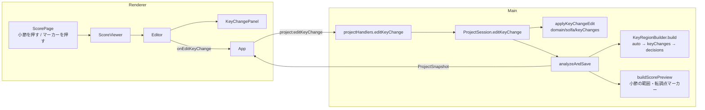

# 設計書

## アーキテクチャ概要

F-5（#5）と同じ方針を延ばす: **Renderer は意図だけを送り、Main が domain の純関数で状態を更新して解析を頭から流し直す**。

- ユーザーの転調点の指定は、解析結果のキャッシュ（`keyRegions`）ではなく**ユーザー判断**として `Project.keyChanges` に持つ
  （`Project` の「正は decisions 側」の原則。再解析しても指定が生き残る）
- 調文脈は `KeyRegionBuilder.build` が「自動生成 → 転調点の指定（`keyChanges`）→ 確認画面の訂正（`keyRegionDecisions`）」の順で組み立てる
- 何をどこに描くか（マーカー位置・小節の範囲）は Main（`buildScorePreview`）で確定させ、Renderer は SVG に載せるだけ



## コンポーネント設計

### 1. `KeyChange`（shared/types/KeyRegion.ts・追加）

```typescript
/** 転調点の指定（F-6）。小節の頭から適用する */
export type KeyChange =
  /** この小節から指定の調で読む（区切りが無ければ挿入し、あれば上書きする） */
  | { kind: 'set'; measureIndex: number; fifths: number; mode: 'major' | 'minor' }
  /** この小節の区切りを取り除く（前の区間の調が続く）。曲頭は対象外 */
  | { kind: 'remove'; measureIndex: number };
```

- 調は `KeyRegionDecision` と同じく**調号（fifths）＋旋法**で持つ。異名同音（C♭/B 等）を表で一意に決められ、範囲検証も `tonicForFifths` で済む
- 1 小節につき指定は 1 件（編集で同じ小節の指定を置き換える）
- Editor からの編集もこの型をそのまま送る（`set` / `remove` が編集操作と 1 対 1 に対応するため別型を作らない）

### 2. `Project.keyChanges` とスキーマ v2（storage/projectSchema.ts）

- `Project` に `keyChanges: KeyChange[]` を追加し、`SCHEMA_VERSION` を **2** に上げる
- `migrate`: v1 → v2 は `keyChanges: []` を足す。アーキテクチャ設計書「版数の増分とマイグレーション実装をセットで行う」
- **版数を上げる理由**: v0.3.0 は公開済み。版数 1 のまま足すと旧アプリが未知のフィールドとして黙って捨て（Zod の既定）、
  旧アプリで開いて保存しただけでユーザーの転調点が消える。v2 にすれば旧アプリは「新しいバージョンのアプリで作成されたファイル」として安全に失敗する
- `ProjectStore.create` は `keyChanges: []` で作る

### 3. `applyKeyChangeEdit`（domain/solfa/keyChanges.ts・新規）

```typescript
applyKeyChangeEdit(
  keyChanges: readonly KeyChange[],
  edit: KeyChange,
  context: { measureCount: number },
): KeyChange[]; // 同じ小節の指定を置き換え、小節順に並べた新しい配列
```

- 検証（違反は `KeyChangeEditError`。Renderer は入力を制限しているため、来るのは画面と Main の食い違いに限られる）:
  - `measureIndex` が整数で `0 <= measureIndex < measureCount`
  - `set`: `tonicForFifths(fifths, mode)` が引ける（-7〜+7 の整数）
  - `remove`: 曲頭（0）でない
- `KeyChangeEditError` は `domain/solfa/errors.ts`（新規）に置く（`AnnotationEditError` と同じ形）

### 4. `KeyRegionBuilder.build` の拡張

```typescript
build(artifacts, structure, decisions = [], keyChanges: readonly KeyChange[] = []): KeyRegionBuildResult
```

- 自動生成 → `ensureHeadRegion` → **`applyKeyChanges`** → `applyDecisions` の順
  - 転調点の指定を訂正より先に当てるのは、確認画面の表は挿入された区間も 1 行として出すため（先に挿入しておかないと、その行の旋法の訂正が `unmatchedKeyDecision` になる）
  - 同じ小節に両方があると訂正が勝つため、**Editor で転調点を指定したらその小節の `keyRegionDecisions` を外す**（`ProjectSession`。後からの操作が勝つ）
- `applyKeyChanges`:
  - `set`: 同じ小節の区間を置き換える／無ければ挿入する。id は自動生成と同じ `key-<measureIndex>`、`source: 'user'`、`offset: 0`
  - `remove`: その小節で始まる区間を取り除く
  - 範囲外の小節・取り除く区間が無い・曲頭の `remove` は例外にせず `unmatchedKeyChange` として報告（ユーザー入力由来。再解析で小節数が変わったときに起き得る）
  - 主音を引けない `set` は `unsupportedKeySignature`（partId: null）として報告
  - 最後に小節順に並べ直し `mergeAdjacent`（前の区間と同じ調を指定した転調点は消える＝存在しない転調点を描かせない原則）
- 小節数（範囲判定の上限）は `build` が走査中に求めている `previousEnd`（確定構造の通し小節番号の終端）を使う

### 5. `KeyRegionIssue` に `unmatchedKeyChange` を追加（shared/types/Issues.ts）

```typescript
| { kind: 'unmatchedKeyChange'; measureIndex: number }
```

### 6. `ProjectSession.editKeyChange`

```typescript
editKeyChange(edit: KeyChange): SessionSnapshot
```

- `applyKeyChangeEdit(project.keyChanges, edit, { measureCount })` → 同じ小節の `keyRegionDecisions` を外す → `analyzeAndSave`
- `measureCount` は `score.systems` の通し小節番号の終端（`firstMeasureIndex + measureCount` の最大）
- **承認は無効化しない**。F-6 は歌い手の解釈の指定で、確認画面の対象（音部記号・調号の読み取り結果）を変えないため（注釈の編集・設定変更と同じ扱い）
- `analyze` は `project.keyChanges` を `KeyRegionBuilder.build` に渡す

### 7. IPC（channels / contract / handlers / preload / main/index）

- `project:editKeyChange`: `(edit: KeyChange) => IpcResult<ProjectSnapshot>`。`editAnnotation` と同じ形

### 8. 楽譜プレビュー（shared/types/ScorePreview.ts・domain/render/scorePreview.ts）

`ScorePreviewPage` に 2 つ足す:

```typescript
/** 小節の範囲（段の全譜表の縦範囲 × stack の横範囲）。押した位置から小節を決めるのに使う */
measures: ScorePreviewMeasure[]; // { measureIndex, x, y, width, height }
/** 調の区切りの印（KeyRegion 1 件につき 1 つ。曲頭を含む） */
keyChanges: ScorePreviewKeyChange[];
// { measureIndex, x, y, height, tonicStep, tonicAlter, mode, source }
```

- 小節の範囲: その段の全譜表の `extent`（上端の最小〜下端の最大、上下に半譜線間隔の余白）× stack の横範囲。段・stack・譜線が分からない小節は作らない（推測で描かない）
- マーカー: 区切りの開始小節の範囲の左端（x）・上端（y）・高さ。位置が取れない区切りは印を作らない（Editor の一覧からは開ける）
- `ScorePreviewInput` に `keyRegions` を足す

### 9. Renderer

- **`scoreLabels`**: `keyLabel(step, alter, mode)`（例 `F♯ 短調`。ClefKeyConfirm の `describeKey` を移す）と `KEY_OPTIONS`（30 調の選択肢。`shared/constants` の主音表から作る）
- **主音表を `shared/constants/KEY_SIGNATURE_TONICS.ts` へ移す**: Renderer の選択肢にも同じ表が要り、Renderer は domain を import できない。
  shared は型と定数を置く場所で、表は定数のため置ける。`domain/solfa/keyTable.ts` は表を shared から読み、関数（`tonicForFifths` / `fifthsForTonic`）は domain に残す
- **`ScorePage`**:
  - 転調点マーカー（小節の左端の縦線＋上に調名のラベル。auto=グレー `#757575`、user=青 `#1e88e5`）。`data-key-change` を持ち、押すと `{ kind: 'keyChange', measureIndex }`
  - 位置を押したとき、押した点を含む小節を `measures` から探し `point` の pick に `measureIndex`（無ければ null）を付ける
  - 選択中の小節（`selectedMeasureIndex`）の範囲を枠で示す
  - マーカーは件数が少ないため、スキップ小節と同じく常に描く
- **`KeyChangePanel`**（新規。`AnnotationEditPanel` と同じく画面下端に固定）:
  - 文言: 既存の区切り → 「N 小節目からの調です（自動判定／指定済み）。調を選び直すか、転調点を削除してください。」、
    曲頭 → 「曲の始まりの調です。調を選び直してください。」、新規 → 「N 小節目から転調します。この小節から読む調を選んでください。」
  - 調のドロップダウン（長調／短調の `optgroup`）。初期値はその小節で有効な調。初期値のままなら適用できない
  - ボタン: 「ここから転調」（新規）／「調を変える」（既存）・「転調点を削除」（既存かつ曲頭以外）・「閉じる」
- **`AnnotationEditPanel`**: `point` の対象に小節が分かっていれば「N 小節目から転調」ボタンを出す（`onStartKeyChange`）
- **`Editor`**:
  - 選択状態に `{ kind: 'keyChange'; measureIndex }` を足す。パネルは選択の種類で出し分ける
  - 「調の区切り（N 件）」区画（楽譜プレビューの直前、「階名の表記」の前）: 区切りごとに「N 小節目から G 長調（自動判定／指定済み）」のボタン。押すと転調点パネルを開く
  - `keyRegionIssues` の `unmatchedKeyChange` を「適用されなかった訂正」に並べる
  - 案内文に「小節を押すと、そこから転調できます」を足す
- **`App`**: `editKeyChange` を結線。成功したら出力結果の表示を消す（`editAnnotation` と同じ理由）

## データフロー

### 転調点を挿入する

```
1. 楽譜プレビューで小節の中（階名の無い位置）を押す → ScorePage が measures から小節を決めて point の pick に添える
2. AnnotationEditPanel の「12 小節目から転調」を押す → Editor の選択が keyChange(11) に変わる
3. KeyChangePanel で調を選び「ここから転調」 → onEditKeyChange({ kind: 'set', measureIndex: 11, fifths: 1, mode: 'major' })
4. App → IPC project:editKeyChange → ProjectSession.editKeyChange
5. applyKeyChangeEdit で検証・置き換え → 同じ小節の keyRegionDecisions を外す → analyzeAndSave
6. KeyRegionBuilder.build（auto → keyChanges → decisions）→ SolfaEngine → regenerateAnnotations（手動注釈・削除の保全）→ buildScorePreview
7. スナップショットが返り、マーカー（青）と再計算された階名が描かれる。自動保存される
```

### マーカーを削除する

```
1. マーカーを押す → KeyChangePanel（既存の区切り）
2. 「転調点を削除」 → { kind: 'remove', measureIndex } → 以降は 3〜7 と同じ
```

## エラーハンドリング戦略

### カスタムエラークラス

- `KeyChangeEditError`（domain/solfa/errors.ts）: 範囲外の小節・扱えない調号・曲頭の削除。`toIpcError` は既存の `Error` 分岐で `unexpected` とメッセージを返す（`AnnotationEditError` と同じ扱い）

### エラーハンドリングパターン

- 編集の検証失敗は例外（状態を変えない）
- 再解析時に適用できない保存済みの指定は `unmatchedKeyChange` として報告（部分失敗で全体を止めない）

## テスト戦略

### ユニットテスト

- `applyKeyChangeEdit`: 追加・置き換え・削除・並び順・各検証エラー
- `KeyRegionBuilder.build` + `keyChanges`: 挿入・auto の上書き・削除・前と同じ調のマージ・範囲外・区間の無い remove・曲頭の remove・`keyRegionDecisions` との順序
- `projectSchema`: v1 のファイルを v2 へ移行して読める・`keyChanges` の検証
- `buildScorePreview`: `measures` と `keyChanges` の位置（stack・extent からの計算、位置の取れない区切り）
- `ProjectSession.editKeyChange`: 階名の再計算（範囲内だけ変わる）・同じ小節の decision を外す・承認を維持・手動注釈の保全・保存→再読み込み
- `projectHandlers.editKeyChange`: 成功・`KeyChangeEditError` の変換
- Renderer: `ScoreViewer`（マーカーを押す・小節を押すと measureIndex が付く）、`KeyChangePanel` を含む `Editor`（挿入・編集・削除・曲頭は削除不可・一覧から開く・未変更では適用不可）、`App` の結線、`scoreLabels`（keyLabel・KEY_OPTIONS）

### 統合テスト

- Victoria 実フィクスチャ: 転調点を挿入 → その区間の階名だけが変わる → 保存 → 再読み込み → 出力で維持される

## 依存ライブラリ

追加なし

## ディレクトリ構造

```
src/shared/types/KeyRegion.ts                 # KeyChange 追加
src/shared/types/Project.ts                   # keyChanges 追加
src/shared/types/Issues.ts                    # unmatchedKeyChange 追加
src/shared/types/ScorePreview.ts              # measures / keyChanges 追加
src/shared/constants/KEY_SIGNATURE_TONICS.ts  # 新規（主音表）
src/shared/ipc/channels.ts, contract.ts       # project:editKeyChange
src/domain/solfa/keyTable.ts                  # 表を shared から読む
src/domain/solfa/keyChanges.ts                # 新規（applyKeyChangeEdit）
src/domain/solfa/errors.ts                    # 新規（KeyChangeEditError）
src/domain/solfa/KeyRegionBuilder.ts          # keyChanges の適用
src/domain/render/scorePreview.ts             # measures / keyChanges
src/storage/projectSchema.ts, ProjectStore.ts # v2・マイグレーション
src/main/ProjectSession.ts, ipc/projectHandlers.ts, index.ts
src/preload/api.ts, index.ts
src/renderer/labels/scoreLabels.ts            # keyLabel / KEY_OPTIONS
src/renderer/viewer/ScorePage.tsx, ScoreViewer.tsx
src/renderer/screens/Editor/KeyChangePanel.tsx  # 新規
src/renderer/screens/Editor/AnnotationEditPanel.tsx, Editor.tsx
src/renderer/screens/ClefKeyConfirm/ClefKeyConfirm.tsx  # keyLabel を使う
src/renderer/App.tsx
```

## 実装の順序

1. 型・定数（KeyChange・Project・Issues・主音表の移動）
2. domain（keyChanges・KeyRegionBuilder・scorePreview）とテスト
3. storage（スキーマ v2・マイグレーション）とテスト
4. Main（ProjectSession・IPC）とテスト
5. Renderer（labels・ScorePage/Viewer・KeyChangePanel・Editor・App）とテスト
6. 統合テスト
7. 品質チェック・ドキュメント更新

## セキュリティ考慮事項

- IPC の入力（`KeyChange`）は Main で検証する（`applyKeyChangeEdit`）。範囲外の値で状態を壊さない
- ローカル完結の原則に変更なし（通信を追加しない）

## パフォーマンス考慮事項

- 編集のたびに解析を流し直す（既存方針。Victoria/divisi で数百 ms）
- プレビューに足す `measures` は段×stack の数（divisi でも数百件）で、IPC の payload への影響は小さい

## 将来の拡張性

- 拍位置からの転調: `NoteEvent` に正規化した小節内位置（例: 四分音符単位の分数）を持たせ、`KeyChange` に `offset` を足す。
  `ScorePosition.offset` は既に型にあるため、`KeyRegion` 側の変更は不要
